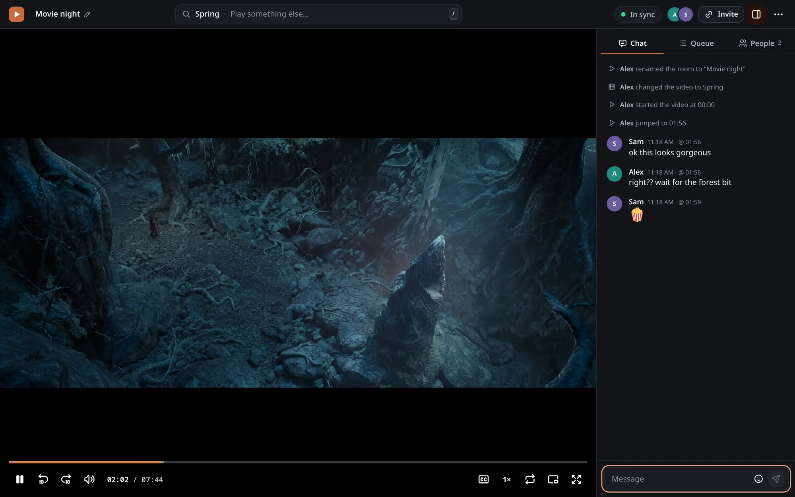

# WatchParty (personal fork)

A self-hosted site for watching videos in sync with friends. This is a personal fork of [howardchung/watchparty](https://github.com/howardchung/watchparty), cut down to the features I use, redesigned, and tuned to run cheaply on a single small server (about 30 MB of RAM when idle).



<sub>Screenshot: <a href="https://studio.blender.org/films/spring/">Spring</a> by Blender Studio (CC BY 4.0).</sub>

## Features

**Watching together**

- Synced play, pause, seek, speed and loop for everyone in the room. Small drift is corrected by briefly nudging the playback speed instead of jumping, and an "In sync" indicator shows how far behind each person is.
- One click on the video plays or pauses for everyone, with a toast saying who did it.
- Optional **ready check**: when someone buffers or joins mid-play, the room pauses until everyone has enough loaded.
- **Next episode**: near the end of an episode, everyone gets an "Up next" card. It plays the next episode from the same release automatically unless someone cancels.
- **Continue watching** on the home page: what you were watching, with progress, resumes in a new room where you left off.

**Sources**

- YouTube, direct video links, HLS (`.m3u8`) and DASH streams.
- **Movies & shows search** through an [AIOStreams](https://github.com/Viren070/AIOStreams) addon: search a title, pick a season and episode, and choose a stream. Streams are grouped by how likely they are to play in a browser.
- **Auto-convert**: each viewer's browser checks what it can play and converts video it can't play natively (MKV, AC3/EAC3 audio, etc.), right there in that viewer's browser. Anyone whose device can't keep up can be sent a converted stream shared by someone else.
- Screen sharing and stream-your-own-file over peer-to-peer WebRTC, with an optional Cloudflare TURN relay for strict networks.
- A queue with drag to reorder.

**Player**

- Fullscreen with auto-hiding controls and cursor, keyboard shortcuts (`?` lists them) and phone gestures.
- Subtitles: upload, search OpenSubtitles, or get them automatically for movies and shows. Adjust the **subtitle offset** for everyone or just yourself; it's remembered per title and episode. Size and style are adjustable.
- Chat with reactions and emoji. Messages show as bubbles over the video in fullscreen or with the sidebar hidden.

**Rooms and hosting**

- Room settings: title, ready check, and when the next-episode card appears.
- Resizable sidebar on desktop, and a bottom sheet on phones.
- One shared instance password instead of user accounts.
- Everything is stored in one SQLite file, so rooms survive restarts. A sidecar container takes a nightly backup.
- One `docker compose up -d` with a Cloudflare Tunnel, so the host doesn't need to open any ports.

## Development

Requires Node 24+.

```bash
npm install
cp .env.example .env   # optional settings; everything works with defaults
npm run dev            # server on :8080
npm run ui             # client dev server (in a second shell)
```

Checks (the same ones CI runs):

```bash
npm run format:check && npm run check && npx vite build
```

## Deployment

One `docker compose up -d` runs the app, a Cloudflare Tunnel and a nightly SQLite backup, with no ports opened on the host. The app image is built on the host from the checkout. See [`DEPLOY.md`](DEPLOY.md) for the step-by-step setup.

## Configuration

All settings are environment variables. See [`.env.example`](.env.example) and `server/config.ts`. The important ones:

| Variable                               | Purpose                                                                                           |
| -------------------------------------- | ------------------------------------------------------------------------------------------------- |
| `APP_PASSWORD`                         | Instance password. Blank turns off auth (fine for local dev only)                                 |
| `SESSION_SECRET`                       | Signs login cookies. Set it in production so logins survive restarts                              |
| `DATA_DIR`                             | Where the SQLite database lives (default `./data`)                                                |
| `CF_TURN_KEY_ID` / `CF_TURN_API_TOKEN` | Cloudflare Realtime TURN relay for screen/file share behind strict networks                       |
| `AIOSTREAMS_MANIFEST_URL`              | Your AIOStreams manifest URL. Turns on movies & shows search. **Secret**: it contains your config |
| `SUBTITLE_LANGS`                       | Preferred languages for automatic subtitles, e.g. `en,es` (default `en`)                          |
| `YOUTUBE_API_KEY`                      | Turns on YouTube search and titles                                                                |
| `OPENSUBTITLES_KEY`                    | Turns on subtitle search (an OpenSubtitles.com API consumer key)                                  |

## License

MIT, as upstream. See [`LICENSE`](LICENSE).
